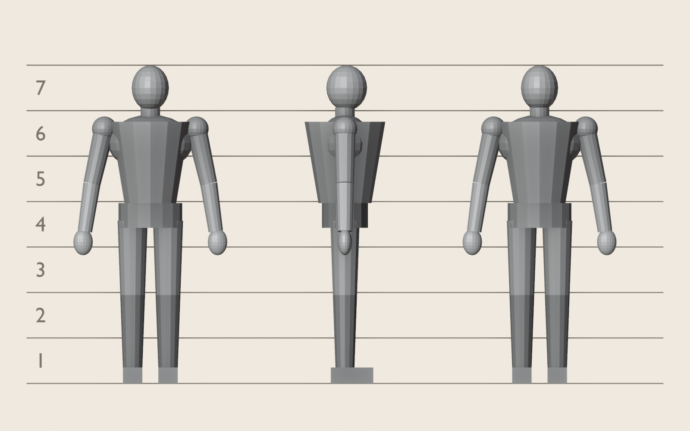
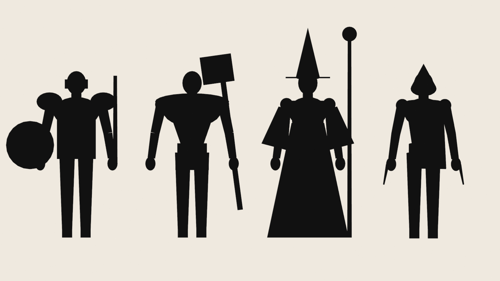
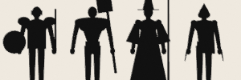
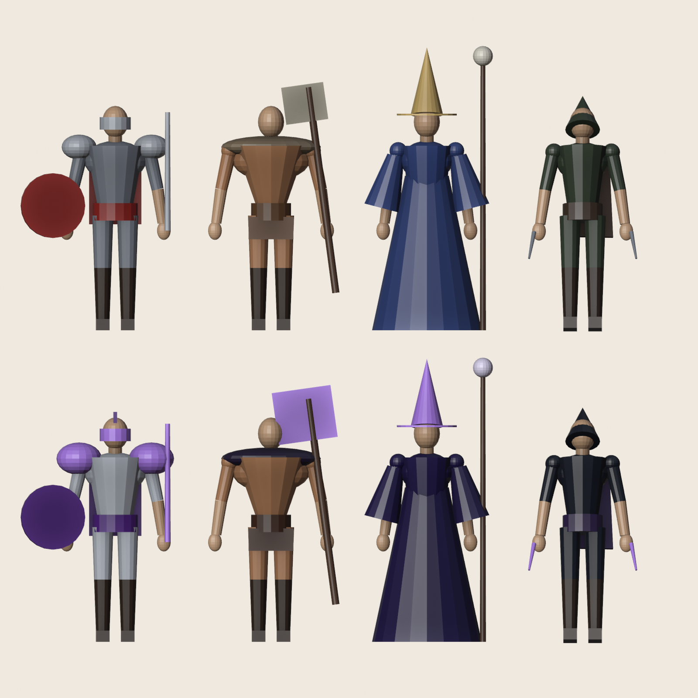

# Guia de arte do Erevia — estilo B (rascunho para aprovação)

Este guia vale para todo asset novo: personagem, armadura, arma, monstro, cenário, efeito e ícone. Se uma peça não segue o guia, ela não entra, mesmo que esteja bonita sozinha. O que deixa o jogo com cara de amador hoje é a mistura: personagens KayKit cabeçudos, um golem modelado em código num estilo diferente e um chão procedural, cada um seguindo uma regra.

Tarefa: tunnel#91 (projeto "6. Remaster visual"). Ferramentas: Blender, blender-mcp e a skill blender-image-to-3d (tunnel#90), todas open source.

---

## 1. O propósito decide o estilo

O Erevia é um MMORPG de mundo aberto no navegador, no PC e no celular. Tem caça em grupo, PvP com karma, clãs, raid boss e, no futuro, cercos de castelo. Três fatos do jogo definem o estilo:

1. **O personagem é pequeno na tela.** A câmera orbita a 18 m por padrão (vai de 5 a 45 m, `client/src/world/scene.ts`). A essa distância, um personagem de 1,8 m ocupa **~130 px de altura num monitor 1080p e ~85 px num celular**. Detalhe fino some. O que se vê são silhueta, massa de cor e brilho.
2. **Muita gente na tela.** Praça cheia, grupo de 6 no raid, cercos. Cada personagem tem que custar pouco, e quem é quem precisa ser reconhecível de longe: classe, raridade do equipamento e se é amigo ou inimigo.
3. **FPS em primeiro lugar.** A meta é 60 FPS no PC e 30 estáveis num celular médio. Isso descarta realismo pesado (normal maps finos, PBR complexo, sombras caras) e favorece **cor pintada e luz desenhada na textura**.

**Conclusão: fantasia estilizada "heroica".** Proporções de herói adulto, formas grandes e exageradas onde importa (ombros, armas, capas, chapéus), detalhe pintado na textura em vez de modelado, e paleta controlada por região. O estilo é próprio: não copia nenhum jogo existente.

**Teste de qualquer asset:** reduza o render a **85 px de altura em tons de cinza**. Se der para dizer a classe e a raridade, passou.

---

## 2. Proporções e silhueta

| | KayKit hoje | Estilo B |
|---|---|---|
| Altura total | ~2,5 cabeças (chibi) | **6,5 a 7 cabeças** (heroico estilizado, não realista) |
| Mãos e pés | pequenos | **10–15% maiores** que o real: segurar arma e ler a pose de longe |
| Ombros | estreitos | **largos**: é onde a armadura mostra a raridade |
| Cabeça | gigante | um pouco maior que o real (~1/6,5): o rosto ainda conta |

Silhueta por classe. Cada uma reconhecível só pelo contorno:

- **Cavaleiro:** um bloco vertical e estável. Ombreiras grandes e arredondadas, escudo grande, capa curta. Elmo de topo plano ou crista.
- **Bárbaro:** um triângulo invertido (ombros muito largos, cintura estreita). Braços à mostra, peles e pelos, arma de duas mãos maior que o normal. Pouco metal, muito couro.
- **Mago:** uma silhueta alongada que se abre em baixo (manto até o chão, mangas largas). Chapéu ou capuz alto e cajado mais alto que ele. É a única classe com a barra do manto larga.
- **Ladino:** uma silhueta fina e inclinada para a frente (postura de bote). Capuz pontudo, cachecol ou capa esvoaçante, duas lâminas curtas. É a classe mais "recortada".

Animações exageram a pose (antecipação e impacto) pelo mesmo motivo da silhueta: em 85 px, pose sutil não se lê.

---

## 3. Cor

### 3.1 Regras gerais
- **Valor primeiro, cor depois:** cada personagem tem uma zona clara (rosto e peças de raridade), uma média (roupa) e uma escura (couro e sombras). Contraste de valor alto entre as três.
- **Saturação controlada:** o cenário é menos saturado que os personagens, e os personagens menos que os efeitos e o brilho de raridade. Assim os olhos vão para quem importa.
- **Sombras puxadas para a paleta**, não para o preto: azul-violeta à noite e no Vale, verde-oliva na floresta.

### 3.2 Raridade (a mesma do jogo, `client/src/ui/items.ts`)
| Raridade | Cor | Como aparece na peça |
|---|---|---|
| Comum | `#e8e1d4` | Tecido e couro crus, metal sem acabamento |
| Bom | `#7bd88f` | Metal polido, um detalhe de cor nas bordas |
| Raro | `#6fa8ff` | Gravuras, peças maiores, um friso emissivo fraco |
| Épico | `#c08cff` | Formas próprias (ombreiras, coroas, asas de elmo), emissivo nas runas |
| Lendário | `#ff9a3c` | Silhueta única, emissivo forte e uma partícula leve por personagem, no máximo |

A raridade se lê pela **forma** primeiro e pela cor depois. Assim funciona também para quem é daltônico.

### 3.3 Paleta por região
| Região | Base | Destaque | Sombra / névoa | Clima |
|---|---|---|---|---|
| Vel'Aran (cidade) | pedra quente `#c9b79c`, madeira `#7a5232` | estandartes `#9e2b25`, ouro `#d6b46e` | `#3b3a52` | acolhedora, viva |
| Arredores | verde vivo `#6f9a4a` | flores `#e8c25a` | `#2f4a3a` | começo leve |
| Campos dos Ossos | grama seca `#a39b5e`, osso `#e2d9bf` | `#b04a2e` (ferrugem) | `#4a3f4f` | morte antiga |
| Ermos Partidos | terra rachada `#8c5a3c` | `#d8873a` | `#3d2a2a` | hostil, quente |
| Vale das Pedras Vivas | rocha `#7d7f86`, musgo `#5f7a44` | runas âmbar `#f0a640` | `#2c3440` | mágico, antigo |
| Cripta Esquecida (raid) | pedra fria `#4a4e5c` | roxo `#8a5cff`, osso | `#14121c` | ameaça |

Cada região ganha uma LUT de cor no render novo (tunnel#92) seguindo esta tabela.

---

## 4. Materiais e texturas

- **Pintura à mão, luz na textura:** um gradiente leve de cima para baixo, oclusão pintada nas dobras e brilho nas bordas. Isso dá volume sem depender de luz cara.
- **Sem normal map fino** nos personagens: em 85 px não aparece e custa memória. Normal map só em peças grandes de cenário, se ajudar.
- Metal: brilho especular pintado, mais o material (tunnel#92) com luz de borda. Nada de reflexo real.
- **Emissivo** só para raridade alta, encantamento (+4 brilha, +7 pulsa), runas e magia. É o que o bloom realça.
- **Atlas:** uma textura de 1024 px por personagem (corpo e armadura). Armas num atlas por família.

---

## 5. Orçamento por objeto (FPS)

Valores iniciais, a ajustar com o `?bench=1` do PC 2 (tunnel#64) e a fatia vertical (tunnel#93):

| Asset | LOD0 | LOD1 | LOD2 | Textura | Materiais |
|---|---|---|---|---|---|
| Personagem (corpo + armadura) | ≤ 8.000 tri | ≤ 3.000 | ≤ 1.000 | 1024² atlas | 1 (+1 emissivo) |
| Arma / escudo | ≤ 800 tri | ≤ 300 | — | atlas da família | 1 |
| Monstro comum | ≤ 4.000 tri | ≤ 1.500 | ≤ 500 | 512–1024² | 1 |
| Chefe / raid | ≤ 15.000 tri | ≤ 5.000 | ≤ 2.000 | 2048² | ≤ 3 |
| Peça de cenário (casa) | ≤ 3.000 tri | ≤ 1.000 | impostor | atlas do kit | 1 |

Por cena:
- até **~150 draw calls** no celular e ~300 no PC;
- partículas: limite global por quadro (tunnel#101);
- distâncias de LOD: LOD1 a partir de ~20 m e LOD2 a partir de ~35 m. Com a câmera padrão a 18 m, os outros jogadores quase sempre estão em LOD1.

Animação: esqueleto Rigify com **até ~45 ossos que deformam** por personagem e 4 influências por vértice. Monstros comuns usam animação em textura (VAT, tunnel#98).

---

## 6. Referências: como gerar e validar (sem copiar ninguém)

Como não vamos copiar a arte de nenhum jogo, a "referência" que a skill blender-image-to-3d recebe é feita aqui:

1. **Folha de proporção por classe:** um boneco neutro de 6,5–7 cabeças, de frente, de lado e de costas, feito no Blender pelo blender-mcp a partir das seções 2 e 3. Ele é a referência de proporção e de câmera da skill.
2. **Folha de silhueta:** as 4 classes em preto lado a lado, renderizadas a 85 px. Precisam ser distinguíveis.
3. **Folha de cor:** as mesmas 4, com a paleta da raridade comum e da épica.
4. O Daniel aprova as três folhas. A partir daí, cada asset passa pelas fases da skill, com renders comparados às folhas e o teste de 85 px em tons de cinza.

### Primeira versão das folhas (bonecos de blocagem)

Geradas por `tools/art/reference_sheets.py` com o Blender em modo headless (o comando está no topo do arquivo). São bonecos feitos de primitivas, só para validar proporção, silhueta e paleta, e não são os modelos finais.

| Proporção (7 cabeças; frente, lado e costas) | Silhueta |
|---|---|
|  |  |

Silhueta no tamanho real do jogo (85 px, celular): 

Cor, com equipamento comum em cima e épico embaixo:

**O que o teste mostrou**
- ✅ Em 85 px, as 4 classes se distinguem só pelo contorno: o cavaleiro pelas ombreiras e pelo escudo, o bárbaro pelo tronco em V e pelo machado, o mago pelo manto e pelo chapéu, o ladino pelo capuz.
- ⚠️ **No bárbaro e no ladino, o épico não se distingue do comum de longe:** muda só a cor. Por isso fica obrigatório que, do raro para cima, cada classe ganhe **uma forma nova na silhueta**:
  - **bárbaro:** chifres no elmo ou crânio, ombreira de osso, lâmina do machado com um formato próprio;
  - **ladino:** capa em tiras, ombreira assimétrica, lâminas mais longas e curvas;
  - **cavaleiro:** crista e ombreiras maiores (como na folha);
  - **mago:** gola alta e um cajado com uma forma no topo.

---

## 7. Onde a arte atual quebra o estilo (para substituir)

- Personagens e esqueletos KayKit (chibi): tunnel#94 e #98.
- O Golem de Pedra modelado em código (`client/src/world/golem.ts`): tunnel#98.
- O chão e a praça procedurais (`client/src/world/ground.ts`): tunnel#99 e #100.
- A cidade do kit Medieval Hexagon: tunnel#100.
- Os ícones de itens em SVG, que não combinam com os modelos: tunnel#102.

## 8. Checklist de entrada de qualquer asset

- [ ] Passa no teste de 85 px em tons de cinza (classe e raridade legíveis).
- [ ] Segue a proporção e a silhueta da classe (seção 2).
- [ ] Usa só cores da paleta da raridade e da região (seção 3).
- [ ] Está dentro do orçamento (seção 5), com LOD0/1/2 exportados.
- [ ] Material único, com emissivo só onde o guia permite.
- [ ] O FPS medido com `?bench=1` não piorou na região onde o asset aparece.
